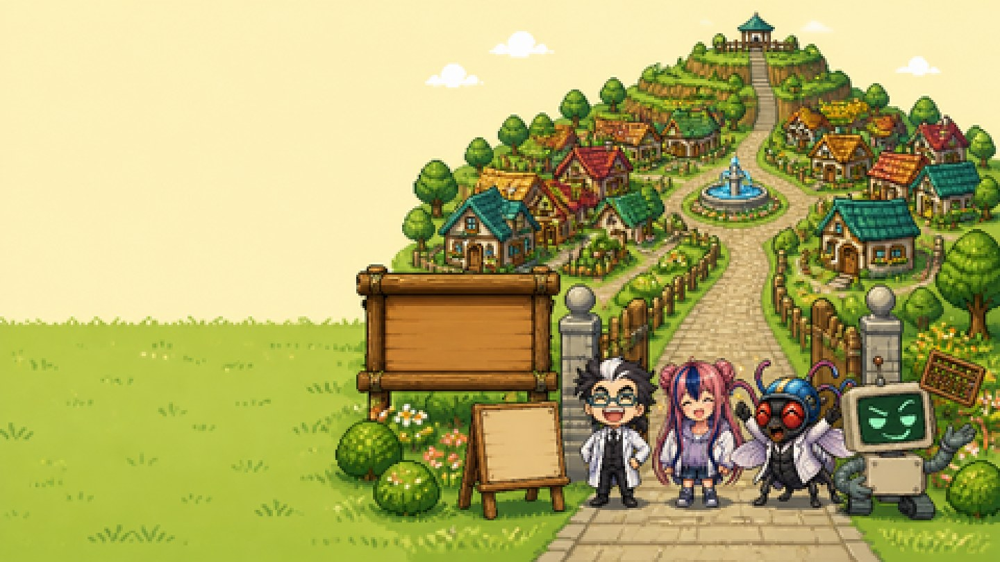

# 인공지능과 자연어 데이터 분석 — 연구실 해설



> 기계가 사람의 말을 "듣는" 데서 그치지 않고 "알아듣게" 하려면, 무엇을 어떤 순서로 해야 할까?

강의 「인공지능 자연어 처리 — 인공지능과 자연어 데이터 분석」 1~8회차를 **비전공 독자용 연구실 해설 페이지**로 다시 만든 시리즈입니다. 교안의 학습내용 24개(회차마다 3개)를 **한 쪽씩**, 쪽마다 칸 세 개로 펼쳐 교안 내용을 거의 다 담았고, 5회(중간)·10회(기말)에 요약정리와 퀴즈를 넣었습니다. 박사 · 조수(하루) · 초파리 연구원 · 주판봇이 진행하고, 대결에서는 인턴 시아·모아가 심판을 맡습니다.

- **바로 보기:** https://adminmrobo.github.io/ai-nlp-data-analysis/
- 쪽 번호 「n-k」 = n회차의 k번째 학습내용. 원 강의 5~8회차는 이 시리즈의 6~9회차입니다.

## 구성 (24쪽 + 요약 2쪽 + 목차)

| 쪽 | 학습내용 | 칸 ①②③ | 더 있는 것 |
|---|---|---|---|
| [1-1](01-1_ai_models.html) | AI 모델과 자연어 분석 | 판단과 인식 · 규칙과 학습 · 딥러닝과 자연어 | 대시보드 · 대결 |
| [1-2](01-2_nl_data_features.html) | 자연어 데이터의 특징 | 정형 대 비정형 · 자연어 데이터 · 다양성과 변화 |  |
| [1-3](01-3_business_cases.html) | 비즈니스 활용 사례 | 뉴스와 여론 · 감성 분석 · ChatGPT와 일 |  |
| [2-1](02-1_analysis_process.html) | 분석 프로세스 | 수집 · 검증 · 검증·전처리 | 대결 |
| [2-2](02-2_tools_environment.html) | 개발환경과 도구 | 파이썬 라이브러리 · R과 패키지 · IDE와 시각화 |  |
| [2-3](02-3_models_methods.html) | 분석 모델과 방법론 | NLP의 발전 · 언어 모델 · 통계 대 딥러닝 | 대시보드 |
| [3-1](03-1_morpheme_overview.html) | 형태소 분석 개요 | 자연어 처리란 · 토큰화 · 불용어와 원형 |  |
| [3-2](03-2_english_nltk.html) | 영어 데이터 분석 | NLTK 소개 · 영어 전처리 실습 · 품사와 빈도 |  |
| [3-3](03-3_korean_konlpy.html) | 한국어 데이터 분석 | 한국어의 특수성 · 분석기 고르기 · 말뭉치와 사전 | 대시보드 · 대결 |
| [4-1](04-1_embedding_overview.html) | 워드 임베딩 개요 | 원핫과 벡터 · 희소 대 밀집 · 4단계와 고려사항 |  |
| [4-2](04-2_tf_idf.html) | 빈도 분석과 TF-IDF | 빈도 분석 · TF-IDF · 가중치 조정과 한계 | 대시보드 · 대결 |
| [4-3](04-3_topic_lda.html) | 토픽 기반 임베딩 | 임베딩의 발전 · 토픽 모델 · 결과 해석 |  |
| [5](05_midterm_review.html) | **중간 요약정리 및 퀴즈** · 교안 문항 · 업무 계산 4문제 | — | — |
| [6-1](06-1_word2vec_overview.html) | Word2Vec 개요 | 분포 가설 · 학습 원리 · 벡터 연산 |  |
| [6-2](06-2_vector_visualization.html) | 단어 벡터의 시각화 | 임베딩 공간 · PCA · t-SNE와 편향 |  |
| [6-3](06-3_similarity.html) | 단어의 유사도 측정 | 유사도가 필요한 곳 · 유사도 · 다른 자와 한계 | 대시보드 · 대결 |
| [7-1](07-1_nlp_ai_models.html) | 분류·회귀와 평가 | 분류 대 회귀 · 벡터화와 모델 · 분류와 평가 | 대시보드 |
| [7-2](07-2_rnn_lstm.html) | RNN과 LSTM | 신경망 기초 · RNN과 기울기 소실 · RNN과 LSTM | 대결 |
| [7-3](07-3_seq2seq.html) | Seq2Seq와 텍스트 생성 | Seq2Seq 구조 · Seq2Seq · 학습과 평가 |  |
| [8-1](08-1_seq2seq_limits.html) | Seq2Seq의 한계와 개선 | 모델의 진화 · 한계와 개선 · 개선책 짝 맞추기 |  |
| [8-2](08-2_attention.html) | 어텐션 메커니즘 | Q·K·V · 어텐션 · 평가와 해석 | 대시보드 |
| [8-3](08-3_transformer.html) | 트랜스포머 | 트랜스포머 구조 · 트랜스포머 · 포지셔널 인코딩 | 대결 |
| [9-1](09-1_modern_lm_overview.html) | 최신 언어모델 개요 | 언어모델의 성장 · GPT와 BERT · 그 밖의 모델과 쓰임 |  |
| [9-2](09-2_transfer_prompt.html) | 전이학습과 프롬프트 | 전이학습 · Hugging Face · 전이학습·프롬프트 | 대시보드 · 대결 |
| [9-3](09-3_llm_rag.html) | LLM과 RAG | LLM과 서비스 · 도메인 특화 · LLM과 RAG |  |
| [10](10_final_review.html) | **기말 요약정리 및 퀴즈** · 교안 문항 · 업무 계산 4문제 | — | — |

## 첫 화면 — 말귀 타워 (3D)

모든 쪽의 첫 화면은 가상의 연구소 건물 **말귀 타워**입니다. 쪽 하나가 한 층입니다(로비 + 26층). 3D는 three.js(jsdelivr CDN)로 그리며, 불러오지 못하면 안내판으로 이동할 수 있어요.

| 층 | 팀 | 쪽 |
|---|---|---|
| 26F | 옥상 전망대 | 10회 |
| 25F | LLM과 RAG | 9-3회차 |
| 24F | 전이학습과 프롬프트 | 9-2회차 |
| 23F | 최신 언어모델 개요 | 9-1회차 |
| 22F | 트랜스포머 | 8-3회차 |
| 21F | 어텐션 메커니즘 | 8-2회차 |
| 20F | Seq2Seq의 한계와 개선 | 8-1회차 |
| 19F | Seq2Seq와 텍스트 생성 | 7-3회차 |
| 18F | RNN과 LSTM | 7-2회차 |
| 17F | 분류·회귀와 평가 | 7-1회차 |
| 16F | 단어의 유사도 측정 | 6-3회차 |
| 15F | 단어 벡터의 시각화 | 6-2회차 |
| 14F | Word2Vec 개요 | 6-1회차 |
| 13F | 중간 점검 라운지 | 5회 |
| 12F | 토픽 기반 임베딩 | 4-3회차 |
| 11F | 빈도 분석과 TF-IDF | 4-2회차 |
| 10F | 워드 임베딩 개요 | 4-1회차 |
| 9F | 한국어 데이터 분석 | 3-3회차 |
| 8F | 영어 데이터 분석 | 3-2회차 |
| 7F | 형태소 분석 개요 | 3-1회차 |
| 6F | 분석 모델과 방법론 | 2-3회차 |
| 5F | 개발환경과 도구 | 2-2회차 |
| 4F | 분석 프로세스 | 2-1회차 |
| 3F | 비즈니스 활용 사례 | 1-3회차 |
| 2F | 자연어 데이터의 특징 | 1-2회차 |
| 1F | AI 모델과 자연어 분석 | 1-1회차 |
| L | 로비 · 안내 데스크 | 목차 |

## 쪽마다 들어 있는 것

- 처음 오신 분께 3줄 요약, 영어 약어 풀이
- 칸 세 개: 가져갈 한 가지 → 왜 이 방법을 쓰나 / 조수가 대신 묻는 수식(접기) → 일상으로 치면 → 칸 대화 → 실험 → 풀이·한계 → 확인 퀴즈(AI 판단 문항 포함)
- 회차마다 대시보드 1개·대결 1판(해당 쪽), 지식 색인과 온톨로지·서지 꾸러미(JSON-LD·Turtle·CSV·CSL-JSON·BibTeX·RIS)
- 모든 실험 데이터는 시드를 고정한 설명용 모형입니다. 원자료와 다르게 쓴 곳은 각 쪽 바닥글에 밝혔습니다.

## 빌드

```
python3 src/build/build.py .          # 27쪽 HTML 생성
python3 src/build/make_covers24.py    # 쪽별 표지(covers/, assets/og/)
```

자료: 안상선, 「인공지능 자연어 처리」 1~8회차 강의 스토리보드·원고(2025, v1.0). 검토 기록: [docs/REVIEW_supoja_persona.md](docs/REVIEW_supoja_persona.md)

글 · 안상선 (www.ahnboat.xyz) · (주)M-Robo 대표 — 캐릭터 이름·설정·그림의 저작권은 안상선(개인)에게 있습니다.
